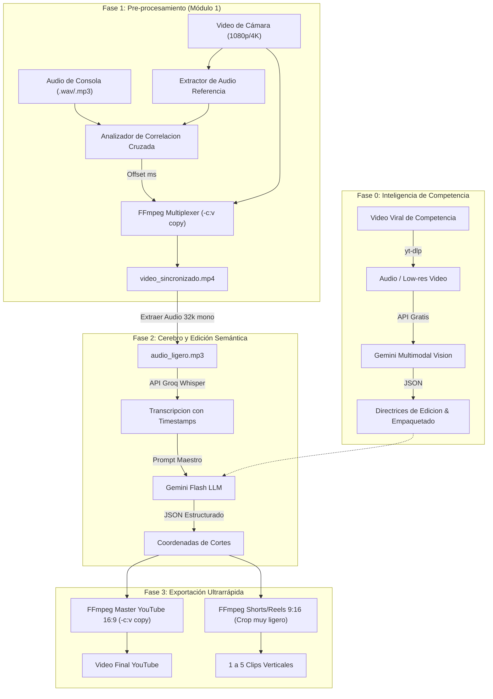

# GUILLION TECHNOLOGIES — ARQUITECTURA TÉCNICA DEL SISTEMA

Este documento describe la arquitectura global, los flujos de datos y la integración de herramientas locales y en la nube para el funcionamiento de **Guillion Technologies**.

---

## 1. PRINCIPIO FUNDAMENTAL: ORQUESTACIÓN LIGERA (LOW-SPEC PC)

El sistema opera bajo una regla estricta:
> **Cero procesamiento pesado en la máquina local.** Toda tarea intensiva de inteligencia artificial (transcripción de audio, análisis semántico de texto y visión de video) se delega a servicios externos gratuitos mediante llamadas API. La computadora local solo ejecuta orquestación de I/O y multiplexado de video con FFmpeg sin re-renderizado (`-c:v copy`).

---

## 2. DIAGRAMA DE FLUJO GENERAL DE DATOS

---

## 3. COMPONENTES TECNOLÓGICOS Y MOTIVO DE ELECCIÓN

| Componente | Función | Justificación Técnica |
| :--- | :--- | :--- |
| **Docker** | Contenedorización | Garantiza que todo corra idéntico en Windows, Linux o servidores sin configurar rutas del sistema operativo. |
| **Python 3.11** | Orquestador | Lenguaje estándar para conectar APIs, scripts de cálculo y llamadas al sistema. |
| **FFmpeg** | Motor multimedia | El motor C de procesamiento de video más rápido y eficiente del mundo. Copia flujos sin usar RAM. |
| **NumPy / SciPy** | Sincronización matemática | Calcula la correlación cruzada de señales de audio en segundos con mínimo consumo de memoria. |
| **Groq (Whisper)** | Transcripción Cloud | Procesa horas de audio en segundos con su tecnología LPU a costo \$0. |
| **Google AI Studio (Gemini)** | Razonamiento y LLM | Ventana de contexto masiva (1M tokens) y salidas JSON estrictas para cortes precisos. |

---

## 4. ESPECIFICACIÓN DE CONTENEDOR DOCKER (MÓDULO 1)

El contenedor del Módulo 1 se basa en una imagen ligera `python:3.11-slim`:
1. Instala el paquete binario de `ffmpeg`.
2. Instala las librerías científicas (`numpy`, `scipy`, `soundfile`).
3. Monta las carpetas de `entrada/` y `salida/` mediante volúmenes para que los archivos queden en tu disco de Windows automáticamente.
